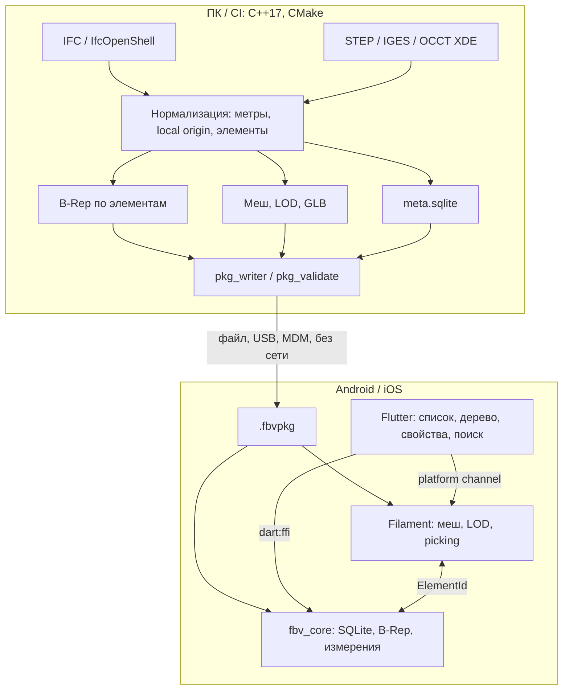

# Архитектура

Схема повторяет согласованный гибрид из раздела 6 ТЗ.

Тяжёлая работа (разбор IFC/STEP, булевы операции, триангуляция) остаётся на ПК. Устройство открывает готовый пакет.

В текущем коде путь IFC — встроенный парсер и аналитический мешер, а не IfcOpenShell/OCCT. STEP на конвертере отклоняется с указанием включить OCCT XDE. На устройстве `fbv_core` читает пакет и SQLite; ленивая B-Rep OCCT и Filament ещё не подключены. Состав пакета — [package_format.md](package_format.md), статус решений — [decisions.md](decisions.md).
