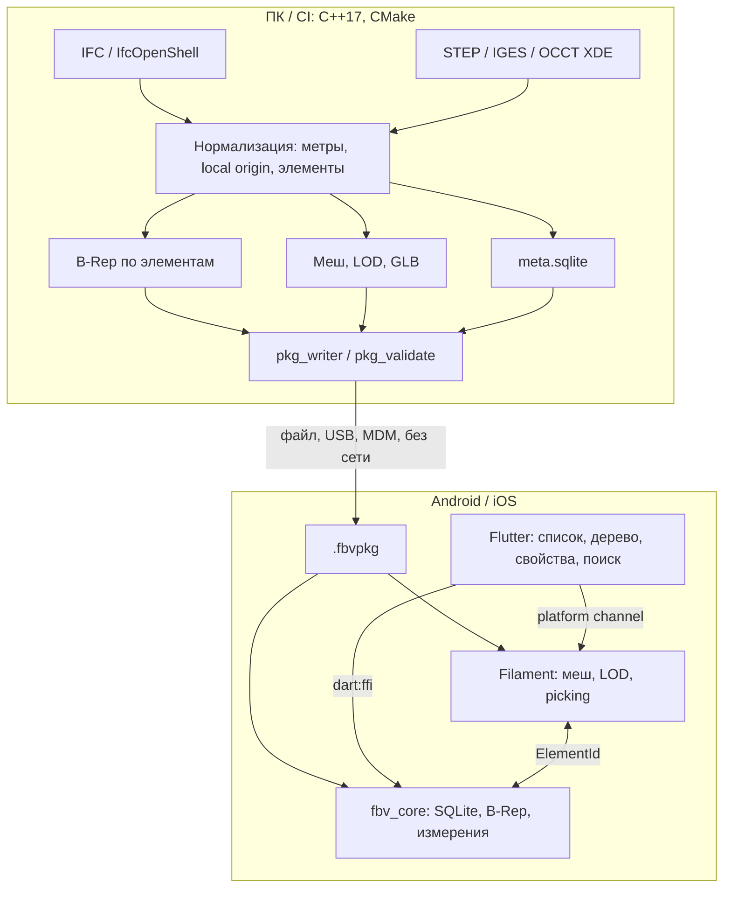

# Архитектура

Схема повторяет согласованный гибрид из раздела 6 ТЗ.

Тяжёлая работа (разбор IFC/STEP, булевы операции, триангуляция) остаётся на ПК. Устройство открывает готовый пакет.

Путь IFC в конвертере: встроенный разбор атрибутов и, если собран `-DFBV_WITH_IFCOPENSHELL`, итератор IfcOpenShell с ядром Open CASCADE 7.8.1. Аналитическое выдавливание остаётся запасным мешером. STEP на конвертере отклоняется с указанием включить OCCT XDE. На устройстве `fbv_core` читает пакет и SQLite; IfcOpenShell и OCCT в мобильное приложение не входят. Состав пакета — [package_format.md](package_format.md), статус решений — [decisions.md](decisions.md).
