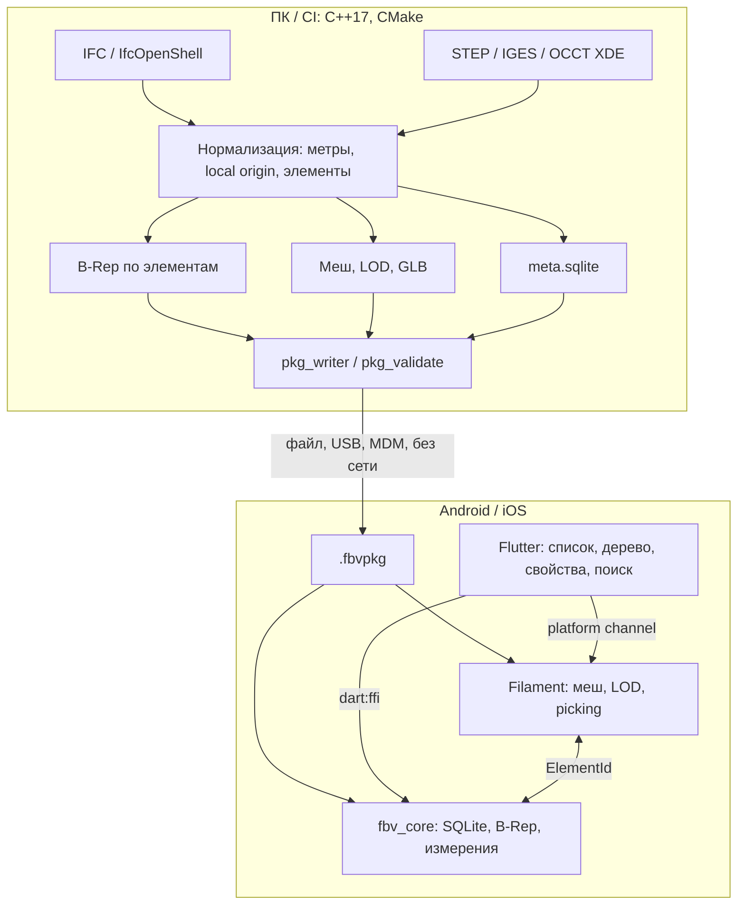

# Архитектура

Схема повторяет согласованный гибрид из раздела 6 ТЗ.

Тяжёлая работа (разбор IFC/STEP, булевы операции, триангуляция) остаётся на ПК. Устройство открывает готовый пакет.

Путь IFC в конвертере: встроенный разбор атрибутов и, если собран `-DFBV_WITH_IFCOPENSHELL`, итератор IfcOpenShell с ядром Open CASCADE 7.8.1. Аналитическое выдавливание остаётся запасным мешером. Треугольники сверх бюджета RAM пишутся во временные файлы и собираются в GLB по одному элементу; форма OCCT не хранится до конца файла. STEP на конвертере отклоняется с указанием включить OCCT XDE. На устройстве пакет и SQLite читает оболочка; сцена Android — Filament. В APK лежат пребилды OCCT (`jniLibs`): проба и чтение BinTools. IfcOpenShell и STEP/XDE на телефоне нет. Измерения в `fbv_core` к сцене не подключены. Состав пакета — [package_format.md](package_format.md), решения — [decisions.md](decisions.md), сверка с ТЗ — [STATUS.md](STATUS.md).
